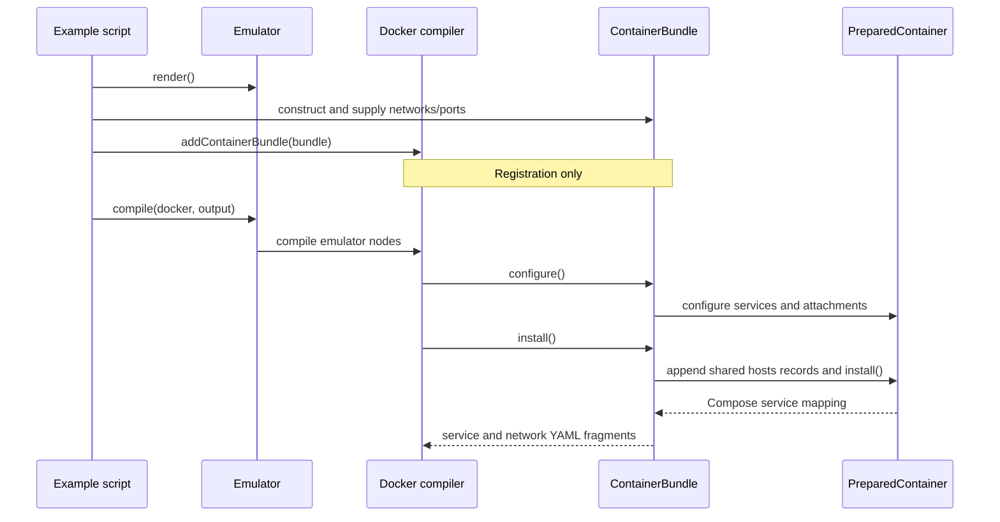

# ContainerBundle design

[ContainerBundle.py](../../seedemu/containerBundle/ContainerBundle.py) defines
ContainerBundle and PreparedContainer. They generate independent Docker services
alongside emulator nodes. Prepared containers are not Base-layer nodes and are
not automatically added to the emulator registry.

This document describes the current shared implementation. For the complete
custom-subclass walkthrough, addresses, aliases, run commands, and tests, see
[A14](../../examples/basic/A14_add_containerBundle/README.md). The concrete
[InternetMap design](internet_map.md) has its runnable example in
[B08](../../examples/internet/B08_internet_map_bundle/README.md).

## Responsibilities and lifecycle

| Component | Responsibility |
| --- | --- |
| ContainerBundle | Own containers, network pools, host-port settings, shared hosts records, and Compose fragments |
| PreparedContainer | Store one service's Compose mapping, attachments, local hosts records, files, and startup commands |
| Docker compiler | Register bundles, invoke configure/install, and combine their output with emulator-node services |

Subclasses create prepared containers in `__init__`, set resource requirements,
and configure service attributes in configure(). Render the emulator before
calling `addInternalNetwork()` so its checks can use configured interfaces;
constructing or registering a bundle does not itself require rendering.
Registration alone does not run configuration.

The base configure() asserts the `_required_port_count` minimum, then sets
`_is_configured = True`. Subclasses call it before their own setup, so the flag
does not prove that subclass work succeeded. printEtcHostsRecords() requires
the flag; call it after successful compilation.

Configuration and installation are not idempotent: attachments and records are
appended, context directories are created, and derived-image generation consumes
the image attribute. Treat them as one compilation pass. Building and starting
containers are separate actions from compilation.

## Identity and lookup

`_createContainer(local_name, suffix)` registers an object under its unsuffixed
logical key. getContainer(local_name) uses that key. getContainers() returns a
shallow copy of the mapping, retaining its objects; getEmulator() and getSuffix()
expose the bundle inputs.

| Value for logical name worker and suffix .example | Result |
| --- | --- |
| Registration key and getName() | worker |
| getHostname() | worker.example |
| Compose service key, final container_name, and build directory | worker.example |

The suffix is appended verbatim. getHostname() does not set Docker's hostname
attribute or the container's OS hostname, and does not isolate networks or ports.

## External network pools

`addExternalNetwork(network_name, prefix, ip_addresses, default_route,
driver="bridge")` appends a pool to `_external_networks` and returns the bundle.
The stored entry has network_name, prefix, ip_addresses, default_route, type
(driver metadata), and network_config containing driver/IPAM settings.
These are bundle-created Compose networks, not `external: true` declarations.

The method parses a canonical IPv4 subnet and gateway, requires a nonempty pool
covering every prepared container, and checks membership, gateway exclusion,
and unique addresses. Host-network containers count toward this pool minimum
even if a concrete bundle leaves their slots unused. It does not inspect existing
Docker networks or reserve addresses. The subclass assigns pool entries to
containers; registration itself does not attach them.

`PreparedContainer.joinExternalNetwork(network_name, hostname, ip_address)`
checks IPv4 syntax and records attachment metadata. It sets a Compose static
address only if the network has no existing service entry. The hostname is
metadata; this method does not create hosts aliases.

During bundle installation, referenced non-emulator networks are matched by
network_name against the pool list. Matching entries supply network_config;
unmatched names get an empty definition. Static addresses require the generated
network's subnet to contain them.

## Internal emulator networks

`addInternalNetwork(asn, network_name, ip_addresses, default_route="")` resolves
the Base-layer AS/network and stores asn, network_name, full_network_name,
ip_addresses, and default_route. The full name comes from Network.getFullName().
Supply ASN strings consistently with registry scopes.

A supplied gateway must match a configured router interface. An omitted gateway
is looked up in the rendered registry; no matching entry can leave it empty.
The pool must meet `_required_internal_address_count`. Only that many leading
addresses are checked for availability against configured emulator interfaces.
There is no allocation or reservation, and pending prepared-container attachments
are not included in that check. Callers must avoid conflicts across containers
and bundles.

`PreparedContainer.joinInternalNetwork(asn, network_name, ip_address, hostname,
default_route)` validates the address and any explicit gateway, records the
attachment, and uses the full network name as the Compose key. Existing Compose
addresses are retained. The first nonempty gateway becomes `_default_route` for
startup preparation. A container can have external and internal attachments;
a host-network service should not also have these Compose network attachments.

`joinInternalNetwork()` adds the SEED metadata labels consumed by InternetMap
only when the service has no existing labels. The container is represented as
role `Host`, using the supplied ASN, hostname, network name, and address, plus
the `custom` marker. Containers without an internal attachment receive no map
labels from ContainerBundle.

The current metadata shape has one `net.0` entry. Calling
`joinInternalNetwork()` more than once retains every Compose network attachment,
but the labels continue to describe the first attachment that populated them.
If any labels were configured earlier through `updateServiceConfig()`, the
automatic InternetMap labels are not added; callers that supply their own labels
must provide the complete metadata required by the map.

getInternalNetworks() and getExternalNetworks() copy entry dictionaries and
address lists. Nested external network_config values remain shared. The original
internal input list is stored without a defensive copy.

## Host ports and service attributes

setPorts() copies the supplied list; getPorts() returns a copy of its current
value. The base checks the minimum count but does not reserve or consume ports.
Subclasses choose how to read them; A14 and InternetMap currently use indexes.

PreparedContainer.updateServiceConfig(content) shallowly updates `_service`.
Image, environment, healthcheck, command, ports, and extra_hosts are ordinary
Compose attributes. Existing values for supplied keys are replaced; nested
mappings are not recursively merged.

## Hosts record ownership and delivery

| Owner | Storage | Registration | Scope |
| --- | --- | --- | --- |
| Bundle | `_shared_etc_hosts_records` | bundle.addEtcHostsRecord(name, ip) | Every prepared container |
| Container | `_etc_hosts_records` | container.addEtcHostsRecord(name, ip) | This container only |

ContainerBundle.install() appends shared pairs through each container's public
registration method. Local entries are retained and the shared list is not
aliased, but the container's own list is mutated.

With startup processing enabled, PreparedContainer.install() removes exact
duplicate pairs using a set and stages `IP<TAB>hostname` lines at /tmp/etc-hosts.
Order is unspecified. Distinct IPs for the same name remain separate lines;
there is no implicit hostname override. A startup command appends this file to
/etc/hosts when the container starts. printEtcHostsRecords() prints deduplicated
shared records only.

Network attachment methods do not create these aliases. Shared delivery does
not use Compose extra_hosts, though callers can independently set extra_hosts
as a Compose attribute. setEtcHosts(content) is a legacy path: __etchosts_file
is treated as an ordinary staged destination, not consumed as hosts content.
Use addEtcHostsRecord for the current mechanism.

Bundle records do not update emulator-node hosts files. To publish an explicit
container address to those nodes, register it with an EtcHosts layer before
emu.render(). Prepared-container installation does not render that layer.

## Startup processing and original images

`_start_script_name` defaults to /start.sh. setStartScriptName(name) selects the
path. Passing an empty string disables automatic hosts, route, and startup-script
processing during install(); it does not erase records or reset existing Compose
entrypoint attributes.

For an otherwise unmodified original-image service, configure image, networks,
environment, and health checks, and call setStartScriptName("") before installing.
If no files are staged and no build override is supplied, install() returns an
image-based service without introducing a derived image or wrapper. It still
creates the directory. Stored hosts records and route settings are not applied
in this mode.

When enabled, startup preparation inserts hosts/route commands ahead of application
commands, after a shell prologue when present. A command list without a shebang
is wrapped. A complete script is written to the selected path and depends on a
compatible entrypoint already configured by the image or caller. The default
/start.sh is not guaranteed to exist in arbitrary images.

setEntrypointWrapper(original_entrypoint, commands) replaces the command list,
selects /new-entrypoint.sh, and sets Compose entrypoint to
`["sh", "/new-entrypoint.sh"]`. The wrapper uses set -eu, executes supplied
commands, then delegates with `exec sh "<original_entrypoint>" "$@"`. Supply a
shell-readable original script. A long-running command prevents delegation;
an exec command replaces the wrapper. Arbitrary image ENTRYPOINT/CMD values
are not automatically discovered or reconstructed.

_getDefaultRouteCommands() runs ip route get at container startup to discover
the gateway-facing interface, removes the default route, and adds the selected
gateway. It requires the ip utility and suitable runtime network privileges.

## File staging and derived images

setFile(filename, content) stores destination/content pairs. install() creates
the context directory named by getHostname(), prepares enabled startup files,
and invokes _generateDockerfile().

- No staged files: no Dockerfile is generated; image remains in the service.
- Staged files: generation consumes image for FROM, asserts it is nonempty,
  enables privileged mode, and installs iproute2 and iputils-ping with apt.
  The current generator always adds this package step for derived images.
- _addFile(path, content) uses MD5 of the destination for context filenames and
  emits COPY instructions. Destinations ending in .sh also receive chmod +x.
- The installer writes Dockerfile and sets the service build path.

Files trigger derived-image generation even when startup processing is disabled.
Base images must support the generated apt commands. Generating a Dockerfile
does not supply an original entrypoint script that the base image lacks.
The current implementation uses chdir() without exception-safe restoration;
installation assumes the compiler's output-directory workflow.

ContainerBundle.install() combines prepared services, excludes emulator-owned
network definitions, and returns `(services_yaml, networks_yaml)`. With no
services it returns two empty strings.

## Runnable examples and validation

Use the example READMEs for concrete source walkthroughs, generated services,
addresses, aliases, ports, prerequisites, run commands, and test instructions:

- [A14 custom ContainerBundle](../../examples/basic/A14_add_containerBundle/README.md)
- [B08 InternetMap bundle](../../examples/internet/B08_internet_map_bundle/README.md)

Both provide example.yaml and test_runtime.py using ComposeRuntimeTest. Their
checks establish those scenarios, not universal image, entrypoint, or address
allocation compatibility.
