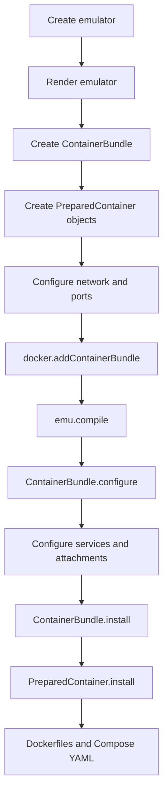
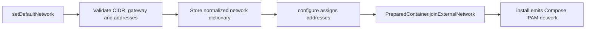
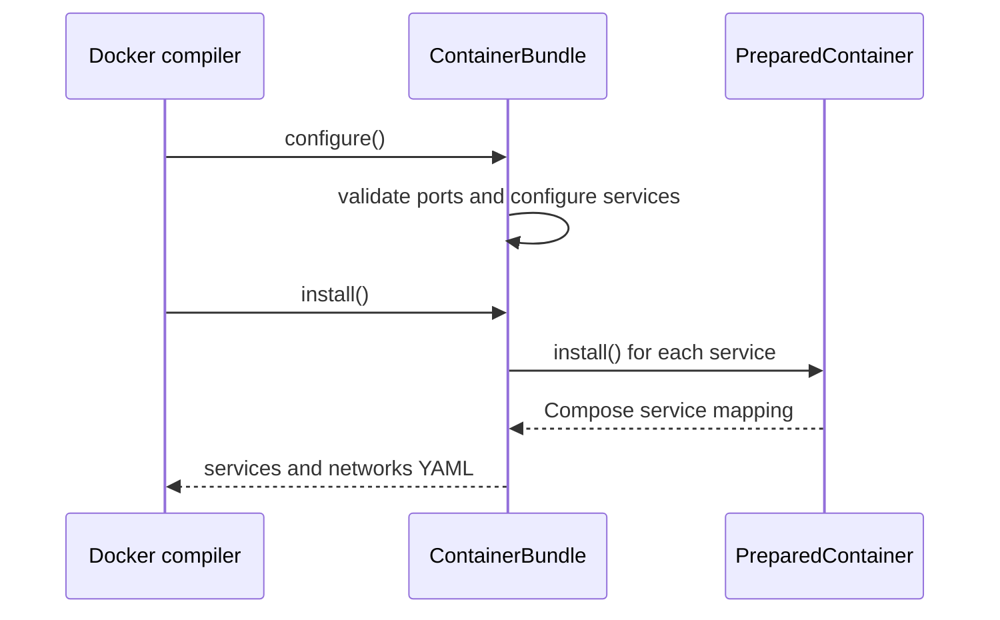
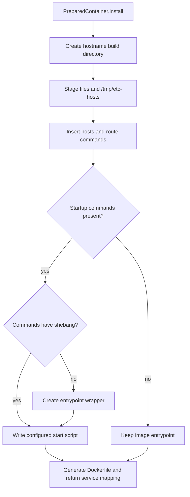

# Add a group of containers to emulator

Created: October 8, 2026 

## Current implementation: two cooperating classes

`seedemu/containerBundle/ContainerBundle.py` defines two layers of
responsibility:

- `ContainerBundle` owns a group of services, shared network configuration,
  port allocation, and the Compose fragments returned to the Docker compiler.
- `PreparedContainer` owns one service definition, its network attachments,
  staged files, startup commands, and generated Dockerfile context.

The lifecycle is:



## `ContainerBundle` design

Subclasses normally create their containers in `__init__`, configure them in
`configure()`, and rely on the compiler to call `install()`:

```python
class ExampleBundle(ContainerBundle):
    def __init__(self, emulator, suffix=".example"):
        super().__init__(emulator=emulator, suffix=suffix)
        self._createContainer("backend", suffix)

    def configure(self):
        self._required_port_number = 1
        super().configure()
        backend = self.getContainer("backend")
        backend.setContentAttribute({
            "image": "busybox:latest",
            "command": "sleep infinity",
        })
```

`_createContainer(local_name, suffix)` registers a `PreparedContainer`. The
logical name is used as the Compose service name; its generated hostname is
`local_name + suffix`. `getContainer()`, `getContainers()`, `getEmulator()`,
and `getSuffix()` provide inspection access.

### Default network

`setDefaultNetwork()` defines the isolated Docker network shared by bundle
services:

```python
bundle.setDefaultNetwork(
    name="example_network",
    prefix="172.30.0.0/24",
    ip_addresses=["172.30.0.10", "172.30.0.11"],
    default_router="172.30.0.1",
    type="bridge",
)
```

`prefix` is an IPv4 subnet in CIDR notation. The method validates the subnet,
gateway, address count, subnet membership, duplicate addresses, and gateway
exclusion. It also creates the Compose IPAM configuration. Addresses are
assigned in container creation order. `getDefaultNetwork()` returns the
stored dictionary, including the generated `network_config`.

The resulting structure is consumed by `configure()` and `install()`:

```python
{
    "name": "example_network",
    "prefix": "172.30.0.0/24",
    "ip_addresses": ["172.30.0.10", "172.30.0.11"],
    "default_router": "172.30.0.1",
    "type": "bridge",
    "network_config": {
        "driver": "bridge",
        "ipam": {"config": [{"subnet": "172.30.0.0/24", "gateway": "172.30.0.1"}]},
    },
}
```

`setDefaultNetwork()` does not attach containers immediately. A bundle's
`configure()` method selects an address for each container and calls
`joinExternalNetwork()`. Later, `install()` emits the `network_config` as the
Compose network definition.



### Ports and lifecycle

`setPorts()` stores a copy of the host-port pool. A subclass sets
`_required_port_number` before calling `super().configure()`; the base method
then validates that enough ports were supplied. The subclass consumes ports
and fills service attributes during the same `configure()` call.

`install()` calls `PreparedContainer.install()` for every registered service,
filters emulator-owned networks from the bundle network section, and returns
the generated service and network YAML fragments.



`getEmuHostNetworkInfo()` scans rendered emulator hosts and returns the first
usable network, host address, and default router. It is intended to run after
`emu.render()`, because it reads the rendered host and network registries. The
return value is either `None` or the parameter dictionary expected by
`joinInternalNetwork()`:

```python
{
    "network": "net0.as150",
    "hostname": "router150.net0.seed",
    "ip_address": "10.150.0.1",
    "default_route": "10.150.0.254",
}
```

The two methods intentionally share the same field names, so the result can
be passed directly with keyword expansion:

```python
network_info = bundle.getEmuHostNetworkInfo()
if network_info is None:
    raise RuntimeError("No emulator host network is available")

container.joinInternalNetwork(**network_info)
```

This is also the pattern used by bundles that store the result during
construction and later attach selected containers during `configure()`.

The method skips networks without a usable host address and converts address
and router objects to strings. The bundle decides which network to select and
which containers need it. `getInternalHostnameIpMappings()`
and `getExternalHostnameIpMappings()` expose the collected hostname/IP data.

## `PreparedContainer` design

`PreparedContainer` is the mutable build description for one container. It
stores its Compose mapping, internal and external network attachments, staged
files, and startup commands.

`getName()` returns the logical service name and `getHostname()` returns the
name with the bundle suffix. `setContentAttribute()` merges Compose service
attributes:

```python
container.setContentAttribute({
    "image": "busybox:latest",
    "command": "sleep infinity",
})
```

`joinExternalNetwork(network, hostname, ip_address)` attaches the container to
the bundle Docker network with a static address. `joinInternalNetwork()`
attaches it to an emulator network and records the network, hostname, address,
and optional gateway. When `default_route` is supplied, the container records
the gateway and inserts route setup before the application startup commands:

```sh
DEFAULT_ROUTE="10.150.0.254"
IFACE=$(ip route get "$DEFAULT_ROUTE" | awk '{for (i=1;i<=NF;i++) if ($i=="dev") print $(i+1); exit}')
echo "gateway=$DEFAULT_ROUTE interface=$IFACE"
ip route del default 2>/dev/null || true
ip route add default via "$DEFAULT_ROUTE" dev "$IFACE"
```

The commands are inserted after an existing shebang and `set -eu` prologue
when those lines are present. If startup commands are available,
`install()` writes them to the configured start-script path and wraps the
image entrypoint when the commands do not already form a complete script.
This is required when a bundle service must reach the emulator network through
its gateway.

The method is normally called by a bundle during `configure()`:

```python
network = bundle.getEmuHostNetworkInfo()
container.joinInternalNetwork(
    network=network["network"],
    hostname=network["hostname"],
    ip_address=network["ip_address"],
    default_route=network.get("default_route", ""),
)
```

The internal attachment and the external bundle attachment are independent.
A container may therefore have two Compose network entries. The default route
is optional and should be used only when outbound traffic must leave through
the emulator gateway. A service using `network_mode: host` should not also be
attached through this method.

`setFile()` stages a file in the generated image context. `setEtcHosts()`
stages content that is appended to `/etc/hosts` during installation. The
`install()` method creates the hostname directory, writes staged files and the
startup script, generates a Dockerfile when needed, and returns the Compose
service mapping. It also performs the final startup integration: `/tmp/etc-hosts`
is appended to `/etc/hosts`, default-route commands are inserted, and a
wrapper entrypoint is selected when generated commands must run before the
image's normal process. `_addFile()` hashes destination paths to create
staging names for Docker `COPY` instructions.

The installation sequence is:



### `_getDefaultRouteCommands()`

This helper converts a gateway address into shell commands that can run inside
the container. It first asks the kernel which interface reaches the gateway,
then replaces the Docker-provided default route:

```sh
DEFAULT_ROUTE="10.150.0.254"
IFACE=$(ip route get "$DEFAULT_ROUTE" | awk '{for (i=1;i<=NF;i++) if ($i=="dev") print $(i+1); exit}')
echo "gateway=$DEFAULT_ROUTE interface=$IFACE"
ip route del default 2>/dev/null || true
ip route add default via "$DEFAULT_ROUTE" dev "$IFACE"
```

The helper is only used when `joinInternalNetwork(..., default_route=...)`
provides a non-empty gateway. The commands are inserted after an existing
shebang and `set -eu` prologue when present. They are generated at container
startup because Docker assigns the interface name at runtime.

For images that already have an entrypoint, `setEntrypointWrapper()` can run
preparation commands and then delegate to the original entrypoint:

```python
container.setEntrypointWrapper(
    original_entrypoint="/entrypoint.sh",
    commands=["cat /tmp/etc-hosts >> /etc/hosts"],
)
```

This avoids assuming that a generated `/start.sh` will be executed by an
image whose `ENTRYPOINT` is fixed.

### Design Assumptions

- Default network: All the containers in the bundle are attached to the isolated external network created for this bundle. This network is not reachable by the nodes in the emulator.
- Emulator networks: If a container needs to communicate with the nodes in the emulator, it also needs to attach to a network internal to the emulator. Which network to use is up to the bundle.
- Limited customization needs: Most part of the container’s Dockerfile and compose entries are already prepared, so there is no need to provide many unnecessary customization APIs.
- /etc/hosts:  The name-ip mappings are only needed by the containers in this bundle; other containers in the emulator do not need the mappings.
- Compose’s extra_hosts entry: provide name-ip mappings to the containers inside the emulator.

### ContainerBundle (Similar to Service)

- init(emulator, suffix):
    - Call `_createContainer(local_name, suffix)` to create the containers in this bundle.
    - Each container has a local name, which is decided by the bundle. The hostname of a container = local name + suffix
- _createContainer(local_name,  suffix):  internal method to create Container.
- setDefaultNetwork(name, prefix, [ip address list]):  This network is an isolated network reserved for this bundle. All the containers will be attached to this network by default. Containers on this network cannot reach the hosts on the emulator, and vice versa. The host machine can reach these containers. A network entry will be created in the compose file.
    - If users do not set this, default values will be used
- setPorts(list):  Allocate a list of ports for the containers; they can use these ports for port forwarding. Port selection is up to the bundle
- configure(): Configure the containers in this group.  When this is called, all the information needed by a container is already decided, so we can generate the final content for all the files of the container.
    - Attach all the containers to the default network:  PrepairedContainer :: joinExternalNetwork(network, hostname, ip_address)
    - Attach containers to a selected emulator network, if needed. The selection method is implemented here (see the notes below). Set the network information for each container.   PrepairedContainer :: joinInternalNetwork(network, hostname, ip_address, default_router)
    - Select ports for each container. These ports are for port forwarding. Container’s local ports are decided locally by the bundle.
    - Construct the final Dockerfile, compose entry, etchosts file, and other files.  Store the final results in the Container object. Construction is based on the prepared format strings defined in this object (or file).
- install():  Call `PreparedContainer::install()`for each container. This API returns the followings:
    - The compose entry strings for all the containers in this bundle.
- File templates:  the file templates is stored in the same file using a dictionary: key —> content
- Attributes
    - __internal_hostname_ip_mappings: record the the hostname-ip mappings for those hosts attached to the internal network. These mappings will be added to the compose entry for all the emulator nodes (using the extra_hosts entry). This is to supplement the /etc/hosts content set by the EtcHosts layer, because we cannot use this layer anymore after the rendering phase. Docker will append these mappings to /etc/hosts when creating containers.
    - __external_hostname_ip_mappings: this is for the /etc/hosts file of all the containers in this bundle.
- **Notes**:
    - If a container needs to communicate with the nodes inside the emulator, it needs to be attached to a network inside the emulator. The Bundle class can use the Emulator object to select networks, reserve IP addresses (each network object has an IP assignment method), and get the default routes on these networks. The selection can be based on ASN, network name, or hostname. The selection is entirely up to the bundle.

### PreparedContainer

Most of the part of this container is already fixed, but a small part of it needs to be decided during the construction time. Eventually, docker compiler creates a folder for each container, and add corresponding entries to docker-compose.yml. 

- init(name, suffix, etchosts_file=”etchosts”):  Set the name of the container.
- install():  Create a folder for the container, and set its content. Use the hostname (local name + suffix) as the folder name. Return the followings:
    - The docker compose service entry for this container.
    - The hostname-ip mappings for the
- joinInternalNetwork(network, hostname, ip_address, default_router): Attach the container to an internal network inside the emulator.
    - Typically, a container should join just one internal network (if it needs to communicate with the nodes inside the emulator). If indeed, it is attached to multiple internal networks, only the first network’s following information is used:  hostname-ip mapping, default router.
    - The IP address should pick from the reserved range, so it does not use the ones that are already allocated.
    - The default router information can be obtained from the network object.
- joinExternalNetwork(network, hostname, ip_address): Attach the container to a network external to the emulator.
- setComposeContent(content: str): Set the docker compose entry for this container. Set __compose_content.
- setDockerfile(content: str):  Set the content of the Dockerfile, use self.__files[”Dockerfile”]
- setEtcHosts(content: str): Set the content of the /etc/hosts file, use self.__files[_etchosts_file]
- setFile(filename, content): Set the content of the other files. Each file set via this API will appear in the output container folder
- Attributes:
    - __emulator: the emulator object
    - __name: str,  __suffix: str
    - __internal_networks:  a list of network (network_name, hostname, ip_address,  default_router)
    - __external_network:  only one (network_name, hostname, ip_address)
    - __files:  Dict[name, content]:   each entry will become a file in the final image folder.
    - __etchosts_file
    - __compose_content


### Notes (future work)

- For each network, reserve a block of IPs for external containers, i.e., for containers added later by the docker compiler.


### Code Example

```python
# VisualizationSystem
class VisualizationSystem(ContainerBundle)

# Example
docker = Docker()

...
emu.render()

# After the rendering 
# Customize and configure the containers in the entire group
bundle = VisualizationSystem(emu, "map.seed")
bundle.setDefaultNetwork(
    name="internetMap_network",
    prefix="172.30.0.0/24",
    ip_addresses=[
        "172.30.0.10",
        "172.30.0.11",
        "172.30.0.12",
        "172.30.0.13",
    ],
    default_router="172.30.0.1"
)
bundle.setPorts(list(range(8090, 8099))

# Docker first invokes bundle.configure() which will configure all the containers;
# Docker then invokes bundle.install() to create a folder for each container, and add entries to docker-compose.yml
docker.addContainerBundle(bundle) 

```
