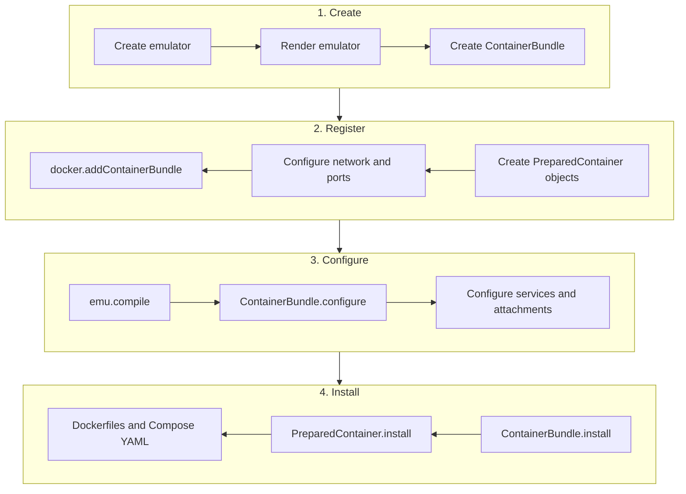
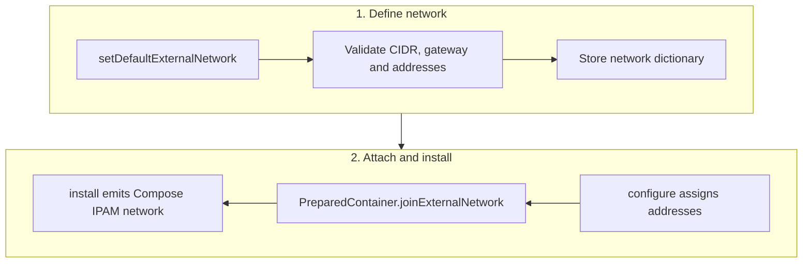
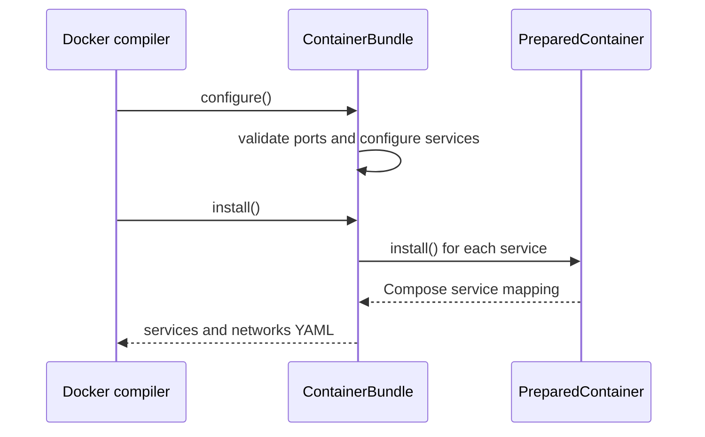
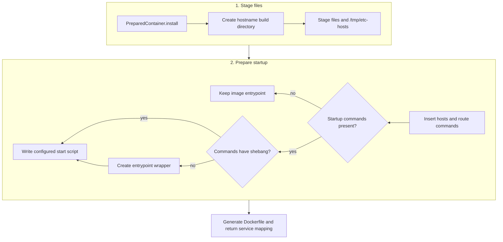

# Add a group of containers to emulator

Created: October 8, 2026 

## Current implementation: two cooperating classes

`seedemu/containerBundle/ContainerBundle.py` defines two layers of
responsibility:

- `ContainerBundle` owns a group of services, shared network configuration,
  port allocation, and the Compose fragments returned to the Docker compiler.
- `PreparedContainer` owns one service definition, its network attachments,
  staged files, startup commands, and generated Dockerfile context.

The lifecycle is:



## `ContainerBundle` design

Subclasses normally create their containers in `__init__`, configure them in
`configure()`, and rely on the compiler to call `install()`:

```python
class ExampleBundle(ContainerBundle):
    def __init__(self, emulator, suffix=".example"):
        super().__init__(emulator=emulator, suffix=suffix)
        self._createContainer("backend", suffix)

    def configure(self):
        self._required_port_number = 1
        super().configure()
        backend = self.getContainer("backend" + self.getSuffix())
        backend.setContentAttribute({
            "image": "busybox:latest",
            "command": "sleep infinity",
        })
```

`_createContainer(local_name, suffix)` registers a `PreparedContainer`. The
registration key, Compose service name, `container_name`, and generated hostname
are all `local_name + suffix`. `getName()` retains the unsuffixed logical name.
Pass the suffixed key to `getContainer()`; `getContainers()`, `getEmulator()`,
and `getSuffix()` provide inspection access.

### Default network

`setDefaultExternalNetwork()` defines the isolated Docker network shared by bundle
services:

```python
bundle.setDefaultExternalNetwork(
    name="example_network",
    prefix="172.30.0.0/24",
    ip_addresses=["172.30.0.10", "172.30.0.11"],
    default_router="172.30.0.1",
    type="bridge",
)
```

`prefix` is an IPv4 subnet in CIDR notation. The method validates the subnet,
gateway, address count, subnet membership, duplicate addresses, and gateway
exclusion. It also creates the Compose IPAM configuration. Addresses are
assigned in container creation order. `getDefaultExternalNetwork()` returns the
stored dictionary, including the generated `network_config`, with a copied
`ip_addresses` list. Configure the external network before calling this getter.

The resulting structure is consumed by `configure()` and `install()`:

```python
{
    "name": "example_network",
    "prefix": "172.30.0.0/24",
    "ip_addresses": ["172.30.0.10", "172.30.0.11"],
    "default_router": "172.30.0.1",
    "type": "bridge",
    "network_config": {
        "driver": "bridge",
        "ipam": {"config": [{"subnet": "172.30.0.0/24", "gateway": "172.30.0.1"}]},
    },
}
```

`setDefaultExternalNetwork()` does not attach containers immediately. A bundle's
`configure()` method selects an address for each container and calls
`joinExternalNetwork()`. Later, `install()` emits the `network_config` as the
Compose network definition.



### Ports and lifecycle

`setPorts()` stores a copy of the host-port pool. A subclass sets
`_required_port_number` before calling `super().configure()`; the base method
then validates that enough ports were supplied. The subclass consumes ports
and fills service attributes during the same `configure()` call.

`install()` calls `PreparedContainer.install()` for every registered service,
filters emulator-owned networks from the bundle network section, and returns
the generated service and network YAML fragments.



### Internal emulator network

`allocateEmuNetworkAddress()` scans rendered host interfaces and selects the
first network with enough free addresses. Each call reserves
`_required_emu_network_address_number` addresses starting at network-address
offset 10 (`10.150.0.10` for `10.150.0.0/24`). It skips all registered host,
router, and border-router addresses, the gateway, network and broadcast
addresses, and earlier bundle reservations. Reservations are stored on the
network as `container_bundle_reserved_addresses`, so bundles share them.
Insufficient candidates receive no partial reservation.

Call after `emu.render()`. On success the method stores the following internal
network dictionary and returns the bundle itself; it returns `None` when no
network has enough capacity or no emulator is associated. The required count
must be a non-negative integer; booleans and other invalid values raise
`ValueError`.

```python
{
    "network": "net_150_net0",
    "emu_hostname": "host150",
    "ip_addresses": ["10.150.0.10", "10.150.0.11"],
    "default_route": "10.150.0.254",
}
```

Read the stored dictionary with `getDefaultInternalNetwork()` after successful
allocation. Select one IP and pass the container's own hostname explicitly:

```python
bundle._required_emu_network_address_number = 2
if bundle.allocateEmuNetworkAddress() is None:
    raise RuntimeError("No emulator host network is available")
network_info = bundle.getDefaultInternalNetwork()
container.joinInternalNetwork(
    network=network_info["network"],
    hostname=container.getHostname(),
    ip_address=network_info["ip_addresses"][0],
    default_route=network_info["default_route"],
)
```

`setDefaultInternalNetwork(name, ip_addresses, default_route)` supplies a manual
selection and returns the bundle. Supply enough addresses for the consuming
services and ensure they are free: this setter does not validate or reserve
them. The getter copies the address list. Prefer explicit allocation before
the getter when no manual network has been set.

The method skips networks without a usable host address and converts address
and router objects to strings. The bundle decides which network to select and
which containers need it. `getInternalHostnameIpMappings()`
and `getExternalHostnameIpMappings()` expose the collected hostname/IP data.

## `PreparedContainer` design

`PreparedContainer` is the mutable build description for one container. It
stores its Compose mapping, internal and external network attachments, staged
files, and startup commands.

`getName()` returns the logical service name and `getHostname()` returns the
name with the bundle suffix. `setContentAttribute()` merges Compose service
attributes:

```python
container.setContentAttribute({
    "image": "busybox:latest",
    "command": "sleep infinity",
})
```

`joinExternalNetwork(network, hostname, ip_address)` attaches the container to
the bundle Docker network with a static address. `joinInternalNetwork()`
attaches it to an emulator network and records the network, hostname, address,
and optional gateway. When `default_route` is supplied, the container records
the gateway and inserts route setup before the application startup commands:

```sh
DEFAULT_ROUTE="10.150.0.254"
IFACE=$(ip route get "$DEFAULT_ROUTE" | awk '{for (i=1;i<=NF;i++) if ($i=="dev") print $(i+1); exit}')
echo "gateway=$DEFAULT_ROUTE interface=$IFACE"
ip route del default 2>/dev/null || true
ip route add default via "$DEFAULT_ROUTE" dev "$IFACE"
```

The commands are inserted after an existing shebang and `set -eu` prologue
when those lines are present. If startup commands are available,
`install()` writes them to the configured start-script path and wraps the
image entrypoint when the commands do not already form a complete script.
This is required when a bundle service must reach the emulator network through
its gateway.

The method is normally called by a bundle during `configure()`:

```python
bundle._required_emu_network_address_number = 1
if bundle.allocateEmuNetworkAddress() is None:
    raise RuntimeError("No emulator host network is available")
network = bundle.getDefaultInternalNetwork()
container.joinInternalNetwork(
    network=network["network"],
    hostname=container.getHostname(),
    ip_address=network["ip_addresses"][0],
    default_route=network.get("default_route", ""),
)
```

The internal attachment writes `ipv4_address` into the Compose network entry.
The internal attachment and the external bundle attachment are independent.
A container may therefore have two Compose network entries. The default route
is optional and should be used only when outbound traffic must leave through
the emulator gateway. A service using `network_mode: host` should not also be
attached through this method.

`setFile()` stages a file in the generated image context. `setEtcHosts()`
stages content that is appended to `/etc/hosts` during installation. The
`install()` method creates the hostname directory, writes staged files and the
startup script, generates a Dockerfile when needed, and returns the Compose
service mapping. It also performs the final startup integration: `/tmp/etc-hosts`
is appended to `/etc/hosts`, default-route commands are inserted, and a
wrapper entrypoint is selected when generated commands must run before the
image's normal process. `_addFile()` hashes destination paths to create
staging names for Docker `COPY` instructions.

The installation sequence is:



### `_getDefaultRouteCommands()`

This helper converts a gateway address into shell commands that can run inside
the container. It first asks the kernel which interface reaches the gateway,
then replaces the Docker-provided default route:

```sh
DEFAULT_ROUTE="10.150.0.254"
IFACE=$(ip route get "$DEFAULT_ROUTE" | awk '{for (i=1;i<=NF;i++) if ($i=="dev") print $(i+1); exit}')
echo "gateway=$DEFAULT_ROUTE interface=$IFACE"
ip route del default 2>/dev/null || true
ip route add default via "$DEFAULT_ROUTE" dev "$IFACE"
```

The helper is only used when `joinInternalNetwork(..., default_route=...)`
provides a non-empty gateway. The commands are inserted after an existing
shebang and `set -eu` prologue when present. They are generated at container
startup because Docker assigns the interface name at runtime.

For images that already have an entrypoint, `setEntrypointWrapper()` can run
preparation commands and then delegate to the original entrypoint:

```python
container.setEntrypointWrapper(
    original_entrypoint="/entrypoint.sh",
    commands=["cat /tmp/etc-hosts >> /etc/hosts"],
)
```

This avoids assuming that a generated `/start.sh` will be executed by an
image whose `ENTRYPOINT` is fixed.
The wrapper's Compose entrypoint is `["sh", self._start_script_name]`, using
the configured script path.
