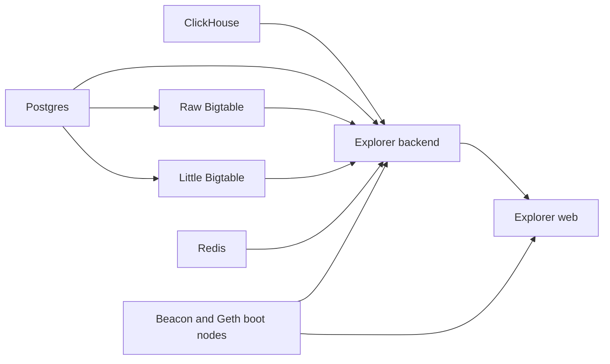
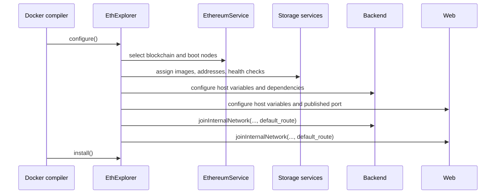
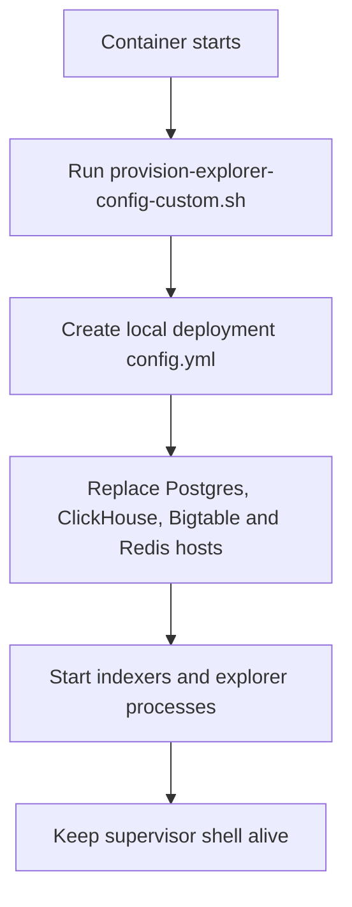

# EthExplorer design

`seedemu.containerBundle.EthExplorer` packages the services required to index
an Ethereum Beacon Chain and expose explorer pages inside a SEED Emulator.
It extends `ContainerBundle` and produces one Docker Compose service for each
dependency and application component.

## Service topology

| Service | Role |
| --- | --- |
| `clickhouse` | Analytics and indexed execution data |
| `postgres` | Relational explorer metadata |
| `redis` | Cache and session storage |
| `littlebigtable` | Bigtable-compatible storage |
| `rawbigtable` | Raw Bigtable-compatible storage |
| `seedemu-ethexplorer-backend` | Beacon/execution indexers and exporters |
| `seedemu-ethexplorer-web` | Explorer API and web-facing processes |

All services join the bundle bridge network with deterministic addresses. The
backend and web services also join an emulator network so they can contact the
configured Beacon and Geth boot nodes.



## Construction and lifecycle

```python
explorer = EthExplorer(emu, ".eth.explorer")
explorer.setPorts([8090])
docker.addContainerBundle(explorer)
```

The constructor creates the seven containers and resolves the emulator host
network. `configure()` performs the following work:

1. Validates that at least one published host port is available.
2. Reads the first blockchain from `EthereumService`.
3. Selects Beacon and Geth boot-node addresses unless explicit overrides were
   provided.
4. Assigns the bundle network addresses and service images.
5. Adds health checks and dependency conditions for storage services.
6. Configures backend and web environment variables.
7. Joins backend and web to the selected emulator network.
8. Generates startup scripts that provision and rewrite `config.yml`.

The Docker compiler then invokes `install()` on every `PreparedContainer` and
publishes the web service port to the host.



## Network and default route

The default bridge network is `ethExplorer_network` on `172.20.0.0/24`.
`setDefaultNetwork()` can replace it, but the supplied address list must have
at least seven entries because every EthExplorer container receives one
address.

The backend and web containers call `joinInternalNetwork()` with the selected
emulator network. Their startup scripts use the returned `default_route` to
identify the interface, remove the Docker default route, and add a route via
the emulator gateway. This is necessary when the explorer must reach Beacon
and Geth nodes through the emulator network rather than through the isolated
bundle bridge.

If the emulator does not expose a usable host network, configuration should
fail clearly instead of producing containers that cannot index the chain.

## Configuration provisioning

The backend and web images contain the upstream provisioning script
`provision-explorer-config-custom.sh`. Their generated startup commands run
that script first, then use `sed` to replace service hosts in the generated
`config.yml`:



The replacement values are the static addresses assigned on the bundle
network. The Beacon and Geth addresses come from `EthereumService` and are
passed through the `CL_HOST` and `EL_HOST` environment variables. Keeping the
provisioning script inside the image allows the bundle to adapt the generated
configuration without exposing the image's original entrypoint implementation
in the emulator source.

## Host override APIs

Use `setBeaconHost()` and `setGethHost()` before `configure()` when the default
boot-node selection is not appropriate:

```python
explorer.setBeaconHost("10.0.0.10")
explorer.setGethHost("10.0.0.11")
```

`getBeaconHost()` and `getGethHost()` expose the values selected for the final
configuration and are useful for diagnostics or tests.

