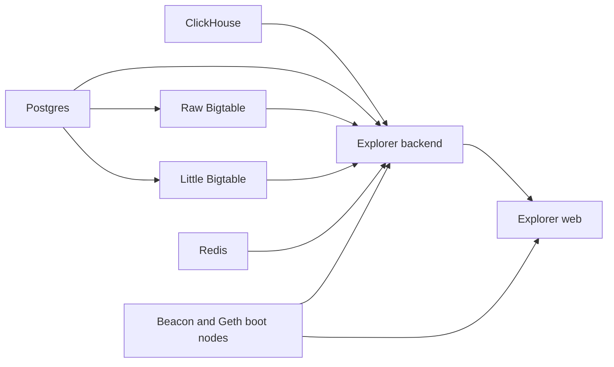
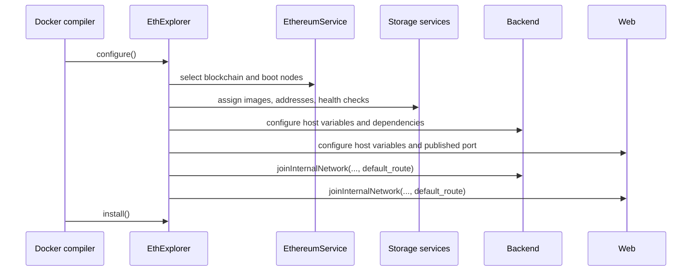
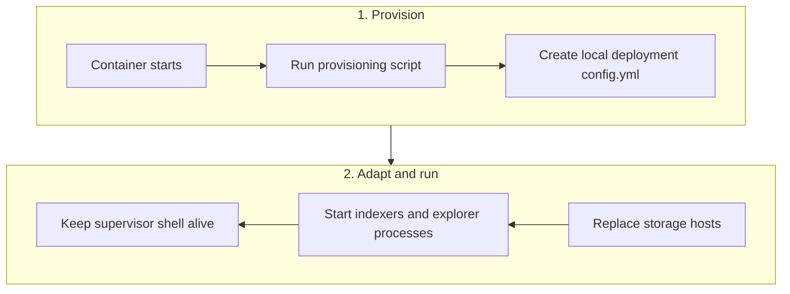

# EthExplorer design

`seedemu.containerBundle.EthExplorer` packages the services required to index
an Ethereum Beacon Chain and expose explorer pages inside a SEED Emulator.
It extends `ContainerBundle` and produces one Docker Compose service for each
dependency and application component.

## Service topology

| Service | Role |
| --- | --- |
| `clickhouse` | Analytics and indexed execution data |
| `postgres` | Relational explorer metadata |
| `redis` | Cache and session storage |
| `littlebigtable` | Bigtable-compatible storage |
| `rawbigtable` | Raw Bigtable-compatible storage |
| `seedemu-ethexplorer-backend` | Beacon/execution indexers and exporters |
| `seedemu-ethexplorer-web` | Explorer API and web-facing processes |

All services join the bundle bridge network with deterministic addresses. The
backend and web services also join an emulator network so they can contact the
configured Beacon and Geth boot nodes.



## Construction and lifecycle

```python
explorer = EthExplorer(emu, ".eth.explorer")
explorer.setPorts([8090])
docker.addContainerBundle(explorer)
```

The constructor creates seven containers, requires one host port, and requests
two internal addresses. Allocation is deferred to `configure()`, which performs
the following work:

1. Validates that at least one published host port is available.
2. Reads the first blockchain from `EthereumService`.
3. Selects Beacon and Geth boot-node addresses unless explicit overrides were
   provided.
4. Assigns the bundle network addresses and service images.
5. Adds health checks and dependency conditions for storage services.
6. Configures backend and web environment variables.
7. Allocates two internal addresses unless a manual internal network is set,
   then attaches the backend at `ip_addresses[0]` and web at `ip_addresses[1]`.
8. Generates startup scripts that provision and rewrite `config.yml`.

The Docker compiler then invokes `install()` on every `PreparedContainer` and
publishes the web service port to the host.



## Network and default route

The default bridge network is `ethExplorer_network` on `172.20.0.0/24`.
`setDefaultExternalNetwork()` can replace it, but the supplied address list must have
at least seven entries because every EthExplorer container receives one
address.

Allocation starts at network-address offset 10, skips occupied addresses and
earlier bundle reservations, and reserves both addresses on one host network.
Use `setDefaultInternalNetwork(name, ip_addresses, default_route)` to supply
two free addresses manually before compilation; this setter does not reserve
or validate them. Render the emulator before allocation.

The backend and web containers call `joinInternalNetwork()` with the selected
emulator network. Their startup scripts use the returned `default_route` to
identify the interface, remove the Docker default route, and add a route via
the emulator gateway. This is necessary when the explorer must reach Beacon
and Geth nodes through the emulator network rather than through the isolated
bundle bridge.

If no host network has two usable addresses, configuration should
fail clearly instead of producing containers that cannot index the chain.

## Configuration provisioning

The backend and web images contain the upstream provisioning script
`provision-explorer-config-custom.sh`. Their generated startup commands run
that script first, then use `sed` to replace service hosts in the generated
`config.yml`:



The replacement values are the static addresses assigned on the bundle
network. The Beacon and Geth addresses come from `EthereumService` and are
passed through the `CL_HOST` and `EL_HOST` environment variables. Keeping the
provisioning script inside the image allows the bundle to adapt the generated
configuration without exposing the image's original entrypoint implementation
in the emulator source.

## Host override APIs

Use `setBeaconHost()` and `setGethHost()` before `configure()` when the default
boot-node selection is not appropriate:

```python
explorer.setBeaconHost("10.0.0.10")
explorer.setGethHost("10.0.0.11")
```

`getBeaconHost()` and `getGethHost()` expose the values selected for the final
configuration and are useful for diagnostics or tests.

## How EthExplorer extends ContainerBundle

`EthExplorer` inherits from `ContainerBundle`. The base class provides generic
container registration, network settings, address reservation, port pools,
hostname/IP mapping accessors, and Compose installation. EthExplorer supplies
the Ethereum-specific service topology and configuration. It overrides
`__init__()` and `configure()`, adds four node-host accessors, and inherits
`install()` without overriding it.

| Responsibility | `ContainerBundle` | `EthExplorer` |
| --- | --- | --- |
| Initialization | Stores emulator and suffix through the dataclass initialization and `__post_init__()`; starts with empty containers and unset networks. | Calls `super().__init__()`, supplies an external network, creates seven containers, sets resource requirements, and initializes node hosts. |
| `configure()` | Checks that the supplied port pool meets `_required_port_number`. | Calls the base check, selects Ethereum nodes, configures storage and applications, attaches networks, and prepares startup commands. |
| `install()` | Installs each prepared container and returns service/network YAML, excluding emulator-owned networks from bundle network definitions. | Inherits this behavior; generated startup scripts and files are materialized by `PreparedContainer.install()`. |
| Beacon/Geth selection | Has no Ethereum-specific node selection. | Adds `getBeaconHost()`, `getGethHost()`, `setBeaconHost()`, and `setGethHost()`. |

### `__init__()`: define the explorer stack

The constructor performs these operations in order:

1. Calls `super().__init__(emulator=emulator, suffix=suffix)` so inherited
   registration, networking, and compiler integration remain available.
2. Sets `_default_external_network = DEFAULT_NETWORK`, using the seven static
   addresses on `172.20.0.0/24`.
3. Calls `_createContainer()` for `clickhouse`, `postgres`, `redis`,
   `littlebigtable`, `rawbigtable`, `seedemu-ethexplorer-backend`, and
   `seedemu-ethexplorer-web`, in that order. This order determines external
   address assignment.
4. Sets `_required_port_number = 1` for the Web UI and
   `_required_emu_network_address_number = 2` for backend/Web internal
   interfaces. Storage services only need the external bundle network.
5. Initializes `__beacon_host` and `__geth_host` to empty strings. Node
   selection, service image attributes, and startup-script preparation happen
   later in `configure()`.

### `configure()`: turn the stack into concrete services

The Docker compiler invokes this method during compilation:

1. `super().configure()` checks the one-port minimum and raises `ValueError`
   before explorer setup if the pool is too small.
2. Fetches `EthereumService`, selects its first blockchain, and fills each
   empty node-host field from the corresponding first bootnode IP. Nonempty
   overrides remain unchanged.
3. Attaches all seven containers to the external network in creation order.
   Retrieves prepared containers using their logical name plus suffix.
4. Configures ClickHouse, PostgreSQL, Redis, and both Bigtable services,
   including database settings, Redis persistence, health checks, and
   dependencies. Reads their actual assigned static IPs from the service
   network mappings for use in application configuration.
5. Configures backend privileges, host PID, capabilities, logging, build
   context, dependency conditions, database-table health check, and the
   `CL_HOST`/`EL_HOST` environment variables.
6. Uses a manually supplied internal network or calls
   `allocateEmuNetworkAddress()` to reserve two addresses. Backend uses the
   first address and Web the second, with the selected default route.
7. Copies `BACKEND_START_SH`, formats its `sed -i` command with storage IPs,
   and assigns it to `seedemu_ethexplorer_backend._start_commands`.
8. Configures Web with the same node-host variables and storage dependencies,
   additionally waiting for backend health. Publishes the final supplied host
   port to container port `5000`, attaches the second internal address, and
   assigns a formatted copy of `FRONTEND_START_SH` to
   `seedemu_ethexplorer_web._start_commands`.

`configure()` prepares Python service descriptions; it does not run the
provisioning or application processes. Inherited installation writes build
contexts, and those processes run when Docker starts the containers.

## Detailed Beacon and Geth host APIs

These four methods are specific to EthExplorer:

| Method | Stored value and effect | Return value |
| --- | --- | --- |
| `setBeaconHost(beacon_host)` | Assigns `__beacon_host`; a nonempty value overrides automatic consensus-layer selection and becomes `CL_HOST` in both containers. | `None` |
| `setGethHost(geth_host)` | Assigns `__geth_host`; a nonempty value overrides automatic execution-layer selection and becomes `EL_HOST` in both containers. | `None` |
| `getBeaconHost()` | Reads the current `__beacon_host`; does not query the emulator or trigger selection. | Current value, initially `""` |
| `getGethHost()` | Reads the current `__geth_host`; does not query the emulator or trigger selection. | Current value, initially `""` |

The setters perform assignment without reachability or address validation.
They are not fluent methods, so call them separately. An empty string allows
the corresponding automatic selection on the next `configure()` call. Set
overrides before compilation: changing these fields after configuration does
not rewrite service environment dictionaries that were already generated.

```python
explorer = EthExplorer(emu, ".eth.explorer.seed")
assert explorer.getBeaconHost() == ""
assert explorer.getGethHost() == ""
explorer.setBeaconHost("10.150.0.71")
explorer.setGethHost("10.150.0.72")
print(explorer.getBeaconHost(), explorer.getGethHost())
explorer.setPorts([8090])
docker.addContainerBundle(explorer)
```

For automatic selection, omit the setters and inspect the getters after a
successful `emu.compile()`. These addresses identify the Ethereum nodes;
they are separate from the two internal addresses allocated to the explorer
containers themselves.

## Adapted backend and Web start scripts

### Why the scripts change

The base images already have `/start.sh` entrypoints:
[backend start.sh](../../docker_images/seedemu-ethexplorer/beaconchain/backend/start.sh)
and [Web start.sh](../../docker_images/seedemu-ethexplorer/eth2-beaconchain-explorer/start.sh).
They run the image's provisioning script and then start their respective
processes. EthExplorer supplies adapted startup command lists, preserving
that sequence and adding storage-host rewriting after provisioning.

The provisioning scripts generate configuration using defaults such as
`postgres` and `redis`. The bundle's actual services have suffixed Compose
names and configurable static addresses. Those short defaults may no longer
identify the intended dependencies. The adapted scripts insert the assigned
external-network IPs so both applications use the same bundle's storage,
including when its external subnet has been overridden.

Rewriting happens **after** provisioning because provisioning recreates
`config.yml`; edits made beforehand would be overwritten. Keeping the image's
provisioning step also preserves its runtime-derived chain settings, ports,
credentials, and schema initialization instead of maintaining a second full
YAML template in Python. The provisioning scripts must themselves complete
successfully before this rewrite runs; rewriting afterward cannot repair a
connection failure that occurs during provisioning.

Internal-network routing is another startup adaptation. Docker initially
supplies a default route, while Beacon/Geth nodes may require the emulator
gateway. `joinInternalNetwork()` records the gateway;
`PreparedContainer.install()` inserts commands to discover the interface and
replace the default route before provisioning and application startup. It
then stages the generated `/start.sh` in a derived image. Both base Dockerfiles
already declare `ENTRYPOINT ["/start.sh"]`, so the replacement script runs at
container startup; assigning `_start_commands` alone does not execute it.

### What the replacement scripts do

| Detail | `seedemu_ethexplorer_backend` | `seedemu_ethexplorer_web` |
| --- | --- | --- |
| Command-list constant | `BACKEND_START_SH` | `FRONTEND_START_SH` |
| Shell | `/bin/sh` | `/bin/bash` |
| Provisioning directory | `/app/local_deployment` | `/app/local-deployment` |
| Runtime configuration | `/app/local_deployment/config.yml` | `/app/local-deployment/config.yml` |
| Processes launched in background | `bc eth1indexer`, `bc rewards-exporter`, `bc statistics` | `/app/explorer`, `/app/validator-tagger`, `/app/frontend-data-updater` |

Both scripts install a `SIGINT` handler, run
`provision-explorer-config-custom.sh`, and exit with status 1 if provisioning
fails. After successful provisioning, `sed -i` rewrites storage endpoints;
a failing `sed` command also exits with status 1. Each process is passed the
corresponding runtime configuration path. The final `while true` loop prints
the date and sleeps to keep the container's main shell alive. This loop does
not monitor background-process health or restart a failed indexer.

The backend's `eth1indexer` retains `-concurrency 1` and
`-blocks.tracemode 'geth'`; its statistics process enables charts, graffiti,
validators, and deposits. The Web script retains scheduled validator tagging
with `-schedule true` and the frontend data updater.

### Storage endpoint substitutions

`configure()` formats `{POSTGRES_HOST}`, `{CLICKHOUSE_HOST}`, `{LBT_HOST}`,
`{RBT_HOST}`, and `{REDIS_HOST}` with their external-network static IPs.

The replacements target these fields rather than replacing every `host` key:

| Configuration fields | Replacement |
| --- | --- |
| `readerDatabase.host`, `writerDatabase.host`, `alloyReader.host`, `alloyWriter.host` | PostgreSQL static IP |
| `clickhouse.host` | ClickHouse static IP |
| `bigtable.emulatorHost` | Little Bigtable static IP |
| `rawBigtable.emulatorHost` | Raw Bigtable static IP |
| `redisCacheEndpoint`, `redisSessionStoreEndpoint` | Redis static IP, retaining the existing port suffix |

Only commands beginning with `sed -i ` receive Python `.format()` expansion.
The other shell lines are copied unchanged, including shell-function braces
and runtime expressions. Each service gets its own copied command list;
formatting does not mutate the shared constants.

## Service identity

Registration keys, Compose service keys, container names, hostnames, and build
directories include the suffix. For example, `postgres` with suffix
`.eth.explorer` becomes `postgres.eth.explorer`. `getName()` retains the
logical name; pass the suffixed key to `getContainer()`. Separate instances
also require independent external networks, subnets, and published ports.

