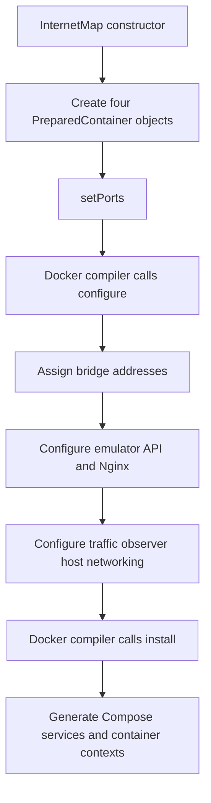
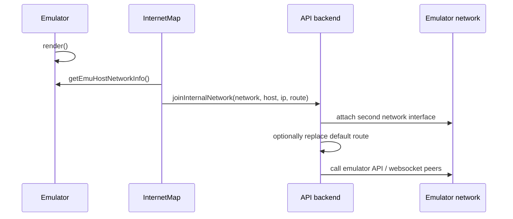

# InternetMap design

`seedemu.containerBundle.InternetMap` packages the services used to visualize
an emulator: the emulator API service, topology UI, geographic UI, and traffic
observer. It is a `ContainerBundle`, so Docker compiles the bundle only after
the emulator has been rendered.

## Responsibilities

The bundle creates four logical services:

| Service | Role | Network behavior |
| --- | --- | --- |
| `seedemu_emulator_service_backend` | Exposes emulator REST and WebSocket APIs | Bundle network; optionally emulator network |
| `seedemu_internet_map_toplogy` | Serves the topology frontend | Bundle network |
| `seedemu_internet_map_geographic` | Serves the geographic frontend | Bundle network and `host.docker.internal` |
| `seedemu_traffic_observer_service_backend` | Captures host traffic | Host network mode |

The traffic observer is deliberately excluded from the bundle bridge network,
because it uses `network_mode: host` and accesses kernel and Docker resources.

## Construction and configuration

```python
internet_map = InternetMap(emu, ".map.seed")
internet_map.setPorts(list(range(8081, 8089)))
docker.addContainerBundle(internet_map)
```

`InternetMap` creates all four `PreparedContainer` instances in its
constructor. `configure()` requires at least three host ports: one for the
traffic observer and one for each frontend. It assigns static addresses from
the default bridge network, writes the Nginx configuration, and stages
`/etc/hosts` entries for the emulator API hostname.

The default network can be replaced with `setDefaultNetwork()`. Its address
pool must contain enough addresses for the three bridge-attached containers;
the host-network traffic observer does not consume an address.



## Optional emulator-network attachment

The normal configuration only needs the bundle bridge network. Some
deployments also need the emulator API container to reach the emulated host
network. The current opt-in API is:

```python
internet_map.enableEmulatorNetwork()
```

This attaches `seedemu_emulator_service_backend` to the network returned by
`getEmuHostNetworkInfo()`. The network information contains the network name,
the selected emulator host name and address, and, when available, its default
router. `PreparedContainer.joinInternalNetwork()` stores that attachment and
can add startup commands that replace the container's default route.

The opt-in call should be made after the emulator has been rendered, so a
usable emulator network is available. If the bundle is extended with more
internal-network consumers, each service should be attached explicitly and
the traffic observer should remain on host networking.



`enableEmulatorNetwork()` is intentionally opt-in. Existing examples that do
not call it retain the original bridge-only topology.

## Reverse proxy and generated files

The topology and geographic containers run Nginx. Their generated upstream
configuration points to the backend service at port `7071`; the geographic
configuration also proxies traffic-observer requests to the host-published
observer port. `setFile()` stages the Nginx configuration, while `setEtcHosts()`
stages the backend hostname mapping. The generated container entrypoint is
preserved through `PreparedContainer` installation rather than requiring the
base image's original script to be copied into the bundle source.

