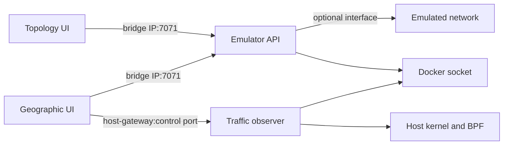

# InternetMap design

[InternetMap.py](../../seedemu/containerBundle/InternetMap.py) extends
ContainerBundle with an emulator API, topology frontend, geographic frontend,
and traffic observer. The [ContainerBundle design](container_bundle.md) describes
shared lifecycle, host records, startup handling, and derived-image generation.

For the concrete single-instance configuration, addresses, URLs, prerequisites,
run commands, and TestRunner usage, see the
[B08 walkthrough](../../examples/internet/B08_internet_map_bundle/README.md).
For implementing a custom bundle, see
[A14](../../examples/basic/A14_add_containerBundle/README.md).

## Services and identity

| Logical key | Image | Connectivity |
| --- | --- | --- |
| emulator_api_server | handsonsecurity/seedemu-emulator-service:1.0 | Private bridge, Docker socket, optional emulator interface |
| internetmap_toplogy | handsonsecurity/seedemu-internet-toplogy:1.0 | Private bridge; API proxy |
| internetmap_geo | handsonsecurity/seedemu-internet-map-geographic:1.0 | Private bridge; API and observer proxies |
| traffic_observer | handsonsecurity/seedemu-traffic-observer-service:1.0 | Host network/PID, debugfs/BPF mounts, Docker socket |

The current spelling toplogy is part of service and image identifiers. The
constructor accepts an emulator and suffix=".map.seed", creates four containers
in the table's order, sets `_required_port_count = 3` and
`_required_internal_address_count = 1`, and allocates no addresses.

Lookup keys omit the suffix. Generated services, container names, and build
contexts append it verbatim. It does not choose a subnet, isolate host ports,
or configure the container's OS hostname.

## External bridge selection

configure() selects the first external pool. If the list is empty, it first
appends DEFAULT_EXTERNAL_NETWORK, making network_config available to the base
installer and preserving IPAM for the static service addresses.

The default internetMap_network bridge has subnet 172.30.0.0/24, gateway
172.30.0.1, and four pool entries starting at .10. API, topology UI, and geographic
UI use indexes 0, 1, and 2. The observer uses host networking, so index 3 is unused.
The default entry is appended by reference rather than deep-copied per instance.

Call addExternalNetwork(network_name, prefix, ip_addresses, default_route,
driver="bridge") before compilation to customize it. The base validation requires
at least four addresses, including the observer slot. Additional external pools
are not attached by InternetMap. The generated subnet must contain service IPs.

Multiple instances require distinct suffixes, network names/subnets, internal IPs,
and host ports. Changing only the suffix does not isolate the default network
or prevent static IP conflicts. Concrete customization is documented in B08.

## Optional emulator-network access

Call addInternalNetwork(asn, network_name, ip_addresses, default_route="") after
rendering the emulator. Checks use configured AS/network interfaces and do not
allocate or reserve addresses. Supply ASN strings consistently with the registry.

An empty internal list leaves the API bridge-only. Otherwise, only the API joins
every configured internal network, using the first IP from each pool. Additional
addresses in each pool are unused; UIs stay on the bridge and the observer on
host networking. The first resolved nonempty gateway is applied at startup,
replacing the API's Docker default route. Directly connected routes still use
their respective interfaces.

The internal attachment provides direct emulator-network connectivity. It is not
required for Docker-socket access. This path uses explicit network pools, with
no automatic address allocator.

When the API joins its first internal network, `joinInternalNetwork()` adds SEED
metadata labels if the service has no existing labels. The API is therefore
returned as a role `Host` node by the emulator API and can be displayed on the
topology map. Later internal attachments are retained in Compose, while the
single `net.0` metadata entry continues to describe the first attachment. With
no internal pool, the API remains bridge-only and receives no ContainerBundle
map labels.

## Host ports and configuration flow

Ports are read by index without consuming the list:

| Index | Use | Compose representation |
| --- | --- | --- |
| 0 | Observer control | `TRAFFIC_CONTROL_ADDR=":<port>"` and `network_mode: host` |
| 1 | Topology HTTP | `<port>:80` |
| 2 | Geographic HTTP | `<port>:80` |

At least three entries are required; extras are unused. The API listens on bridge
port 7071 without a published host port.

Registration through docker.addContainerBundle() stores the object only. During
emu.compile(), after emulator rendering and node compilation, Docker invokes
configure() followed by install(). Configuration:

1. Runs the base port-count check and selects/registers the external bridge.
2. Configures observer control settings, host network/PID, mounts, and privileges.
3. Assigns API/UI bridge addresses and service attributes.
4. Sets UI dependencies using the generated API service name and stages Nginx
   configurations targeting the API bridge address.
5. Optionally attaches the API to every configured internal network and adds
   an alias for each selected address.

The base sets _is_configured during port validation, before the concrete pass
finishes. This does not prove that all configuration succeeded. Reconfiguration
appends records and attachment metadata, so use one pass per compilation workflow.

## API and observer integration

The API mounts /var/run/docker.sock:ro and sets BACKEND_ENV=production.
The observer mounts the socket, host debugfs, and BPF filesystem;
it uses privileged mode and host network/PID namespaces. The pcap binding is
./traffic-observer-service/pcap to /data/pcap, relative to the Compose project.
The configured traffic log timezone is Asia/Shanghai.

Observer control is on the host network, not a Compose ports mapping. Multiple
instances can use different control ports while observing the same Docker host.
Runtime requires a Linux Docker host with the image's expected kernel facilities
and mounts. The bundle does not bind-mount host BTF or /lib/modules.

## Nginx routing

Both UIs stage /etc/nginx/conf.d/default.conf. The API upstream always uses its
bridge IP on 7071, even if it also has an emulator interface.

| Location | Behavior |
| --- | --- |
| / | Serve frontend files with index.html fallback for SPA navigation |
| /api/v1 | Proxy to API, retaining the prefix |
| /emulator/ | Proxy to API with this location prefix replaced by / |
| /traffic-observer/ on geographic UI | Proxy to observer with this prefix replaced by / |

Proxy locations use HTTP/1.1, forwarded headers, WebSocket upgrade headers, and
long timeouts. The geographic UI maps host.docker.internal to host-gateway through
Compose extra_hosts and targets the observer control port. That host mapping is
separate from the bundle's shared hosts mechanism.

## Hosts aliases and startup integration

configure() registers shared records through bundle.addEtcHostsRecord:

| Alias | Address source |
| --- | --- |
| `emulator_api_server-e<suffix>` | API bridge IP |
| `internetmap_toplogy<suffix>` | Topology bridge IP |
| `internetmap_geo<suffix>` | Geographic bridge IP |
| `emulator_api_server<suffix>` | First internal IP, only when attached |
| `emulator_api_server-e<index><suffix>` | Internal IP for each later attachment, where index starts at 1 |

The base appends shared pairs to every prepared container's local list, including
the observer. Enabled startup processing deduplicates pairs, stages /tmp/etc-hosts,
and appends its content to /etc/hosts at startup; line order is unspecified.
This does not populate emulator-node EtcHosts files or register Base-layer nodes.

Original script paths are /start.sh for the API by default, /entrypoint.sh for
UIs, and /usr/local/bin/traffic-observer-entrypoint for the observer. Shared
installation inserts hosts/route preparation and generates /new-entrypoint.sh
when wrapping is needed, delegating to the shell-readable original script.
Staged files trigger derived images, including the current base installer's apt
package step and privileged mode. The images must support these paths/commands.

## Runnable example and validation

The [B08 README](../../examples/internet/B08_internet_map_bundle/README.md) is the
reference for the current single-instance deployment, concrete aliases/ports,
platform selection, prerequisites, generated files, and test commands. It links
the example.yaml manifest and test_runtime.py; this document does not duplicate
the complete example script.

Tests inspect the running containers rather than only the generated Compose
file. They check container state, assigned addresses, bundle and emulator-network
connectivity, port mappings, shared hosts aliases, and map metadata labels. The
topology UI is loaded with Playwright, and the observer workflow refreshes its
interfaces, applies a narrow filter, generates matching traffic, and verifies
that the geographic 3D page receives matching eBPF packet data through its
WebSocket. Published-port and browser probes assume a local Linux Docker host;
see the README for environment constraints.
